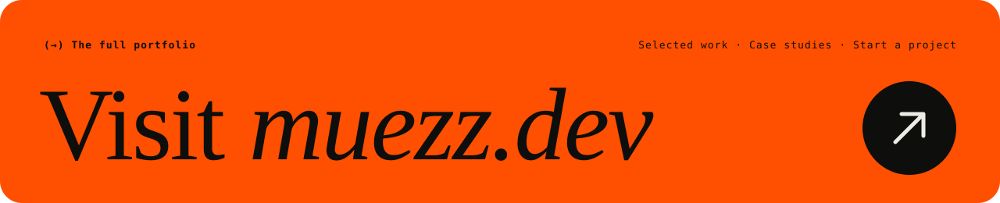

<a href="https://muezz.dev">
  <picture>
    <source media="(prefers-color-scheme: dark)" srcset="./.github/readme/hero-dark.svg">
    
  </picture>
</a>

 
 

  <code>(01)</code>&nbsp;&nbsp;I'm a software engineer who builds elegant products for the web and mobile — from
  scalable web applications to apps that feel native on every screen. One codebase where it counts, typed and
  tested so it can be handed over, and shipped in builds you can try early rather than status decks.

 

## <code>(02)</code> Selected work

|      | Project                                                                                                                         | What it is                                                                      | Built with                    | Year |
| :--- | :------------------------------------------------------------------------------------------------------------------------------ | :------------------------------------------------------------------------------ | :---------------------------- | ---: |
| `01` | **[Pulse](https://muezz.dev/#work)**  Concept · Mobile app                                                        | A training companion that turns heart-rate data into one clear daily goal.      | Flutter · Firebase            | 2026 |
| `02` | **[Slotted](https://muezz.dev/#work)**  Concept · Web platform                                                    | Bookings, waitlists and payments for independent studios, in one calm calendar. | Next.js · Supabase · Postgres | 2026 |
| `03` | **[Fieldnote](https://muezz.dev/#work)**  Concept · Mobile app                                                    | Offline-first notes for field researchers that sync when signal returns.        | Flutter · Supabase            | 2025 |
| `04` | **[flutter_liquid_glass](https://github.com/whynotmake-it/flutter_liquid_glass/pull/133)**  Open source · PR #133 | Fix for the tab indicator getting stuck in the example bottom bar.              | Flutter · Dart                | 2026 |
| `05` | **[flutter-pie-menu](https://github.com/rasitayaz/flutter-pie-menu/pull/81)**  Open source · PR #81               | Custom builders so apps can define their own menu open and close animations.    | Flutter · Dart                | 2025 |

Full case studies — brief, approach and what each one explores — live on <a href="https://muezz.dev/#work">muezz.dev</a>.

 

## <code>(03)</code> How I work

<table>
  <tr>
    <td width="50%" valign="top">
      <code>01</code>&nbsp;&nbsp;<b>Start with the problem</b> 
      Before any code: who it's for and what success looks like. Good software starts as a good question.
    </td>
    <td width="50%" valign="top">
      <code>02</code>&nbsp;&nbsp;<b>One codebase, every screen</b> 
      Flutter for Android and iOS, React for the web — native everywhere, without paying for it three times.
    </td>
  </tr>
  <tr>
    <td width="50%" valign="top">
      <code>03</code>&nbsp;&nbsp;<b>Show, don't report</b> 
      Working builds early and often, so feedback lands while it's still cheap to act on.
    </td>
    <td width="50%" valign="top">
      <code>04</code>&nbsp;&nbsp;<b>Built to be handed over</b> 
      Typed, tested and documented, so the next developer can pick it up without me in the room.
    </td>
  </tr>
</table>

 

## <code>(04)</code> Toolkit

LANGUAGES&nbsp;&nbsp; `TypeScript` `JavaScript` `Dart` `Python` `Go` `HTML` `CSS`  
FRAMEWORKS&nbsp; `React` `Next.js` `Vue` `Flutter`  
DATA&nbsp;&nbsp;&nbsp;&nbsp;&nbsp;&nbsp;&nbsp;&nbsp; `Supabase` `Firebase` `PostgreSQL` `MySQL`

 

 
 

  
    <a href="https://muezz.dev"><b>muezz.dev</b></a>
    &nbsp;&nbsp;·&nbsp;&nbsp;
    <a href="mailto:muezz7055@gmail.com">Email</a>
    &nbsp;&nbsp;·&nbsp;&nbsp;
    <a href="https://discordapp.com/users/478529330171871252">Discord</a>
  

